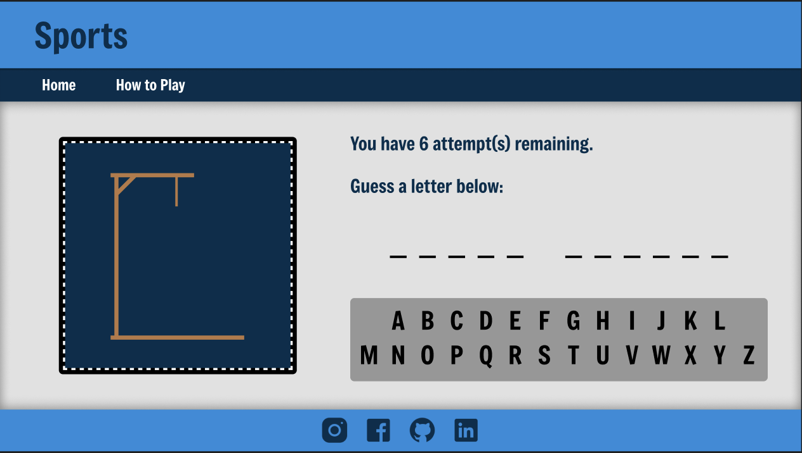

# Hangman

> **This repository is no longer actively maintained.** The project has been refactored into two separate repositories — see [Current Repositories](#-current-repositories) below.

## 📚 Table of Contents

- [Project Overview](#-project-overview)
- [Current Repositories](#-current-repositories)
- [Live Demo](#-live-demo)
- [Credits](#-credits)

## 🧠 Project Overview

The original source code for my own personal, web-based version of the game **_Hangman_**. This monolithic repo contained both the React frontend and Node.js/Express backend. It has since been refactored into two standalone repositories for better separation of concerns and independent deployment.

## 📦 Current Repositories

| Repository                                                      | Description                                           |
| --------------------------------------------------------------- | ----------------------------------------------------- |
| [hangman-client](https://github.com/jawuanlewis/hangman-client) | React frontend — UI, routing, and gameplay experience |
| [hangman-api](https://github.com/jawuanlewis/hangman-api)       | Express backend — REST API, game logic, and database  |

For setup instructions, tech stack details, and contribution info, please refer to the READMEs in those repositories.

## 🚀 Live Demo

- Play the game here: [Hangman](https://hangman.jawuanlewis.dev)
- Initial designs available here: [Figma Designs](https://www.figma.com/design/tOop8Aqlh0zycbjdERI0Ut/Hangman?node-id=0-1&t=uR8s9pxzcX4Zwzt0-1)

**Gameplay example:** Guess the letters of the mystery sport below (6 attempts).

## 🙏 Credits

- **Social Media Icons:** [Icons8](https://icons8.com)
- **Level Images:** generated with [ImageFX](https://labs.google/fx/tools/image-fx)
